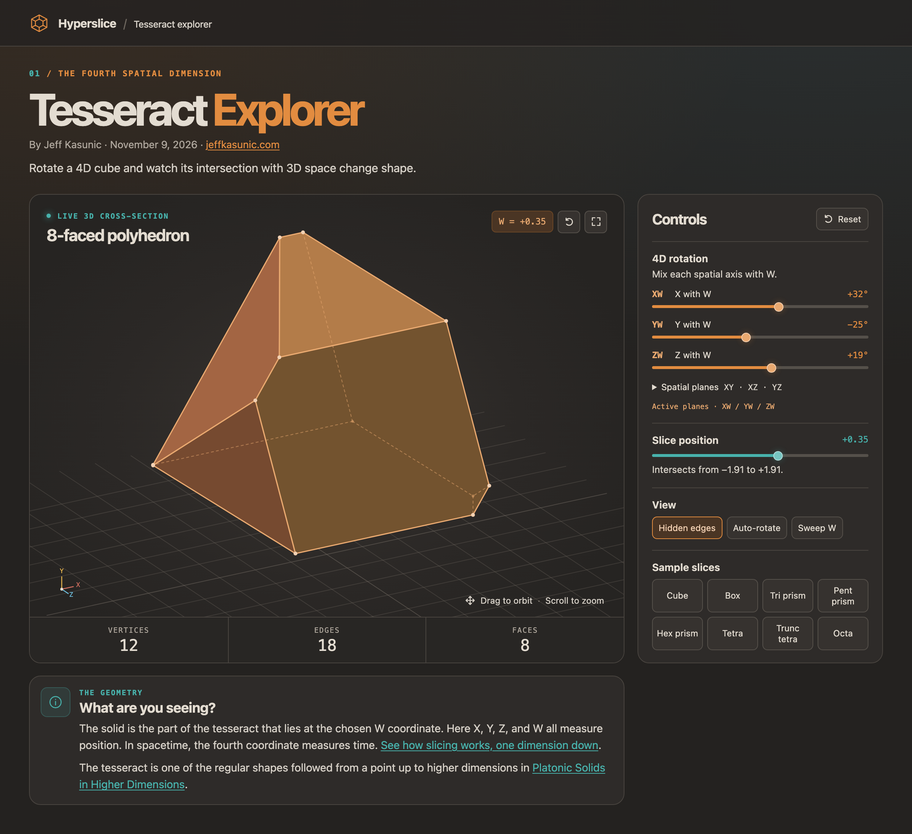
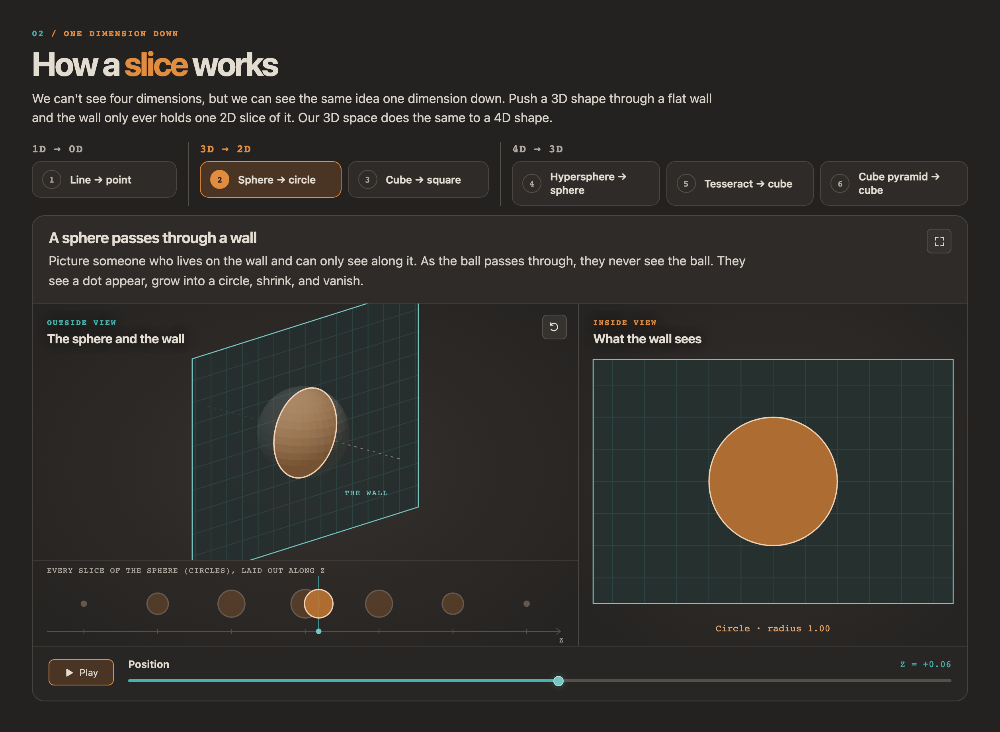

# Hyperslice

An interactive tesseract explorer. Rotate a 4D cube and watch the 3D shape it
makes where it crosses ordinary space: cubes, prisms, octahedra, tetrahedra and
more.

By Jeff Kasunic · November 9, 2026 · [jeffkasunic.com](https://jeffkasunic.com)

For the regular shapes in every dimension, from a point up through the
tesseract and beyond, see
[Platonic Solids in Higher Dimensions](https://jeffkasunic.com/mathematics/platonic-solids.html).



## Features

- **4D rotation:** mix each spatial axis with W (XW, YW, ZW), then turn the
  slice in 3D (XY, XZ, YZ).
- **Slice position:** slide the 3D plane along the W axis.
- **Live cross-section:** vertex, edge and face counts, plus a name for the
  shape that is only given when the geometry really matches it.
- **View options:** show or hide hidden edges, auto-rotate, and sweep W
  automatically.
- **Sample slices:** jump to a cube, rectangular box, triangular, pentagonal or hexagonal prism, tetrahedron, truncated tetrahedron or octahedron.
- **One dimension down:** a guided section that pushes a line, a sphere and a cube
  through a flat wall, then a hypersphere, a tesseract and a cube pyramid through 3D space,
  laying each shape out as a row of slices so the 3D → 2D case can be
  compared with the 4D → 3D one. The tesseract step can open its current slice
  in the explorer, and the section has its own full screen mode.

### Controls

| Action | Mouse / trackpad    | Keyboard (view focused) |
| ------ | ------------------- | ----------------------- |
| Orbit  | Drag                | Arrow keys              |
| Zoom   | Scroll or pinch     | `+` / `-`               |

## How a slice works

The app's own **How a slice works** section builds the idea up one dimension
at a time, from a line through a point up to a tesseract through 3D space.



A tesseract is a 4D cube: 16 corners at every combination of ±1 in X, Y, Z
and W, joined by 32 edges and bounded by 8 cubic cells. We can't see it
directly, but we can see where it crosses our 3D space, the same way a 2D
being living on a flat sheet would only see the polygon where a 3D cube
passes through their sheet.

Each frame, `slice()` in `src/geometry.ts` works it out in four steps:

1. **Rotate.** Each of the 16 corners is turned through the six rotation
   planes in order (XW, YW, ZW, then XY, XZ, YZ). The W rotations tilt the
   tesseract against our space and change which shape the slice makes; the
   other three just turn the result in 3D.
2. **Cut the edges.** The slice is the 3D space where W equals the slice
   position. For each of the 32 edges, if one end is on each side of that
   value, the crossing point is found by linear interpolation:
   `t = (wA − w) / (wA − wB)`. Corners that sit exactly on the slice are kept
   too. Every corner of the cross-section comes from one of these crossings,
   with duplicates merged.
3. **Find the dimension.** Fewer than two points means nothing (or a single
   corner) is touched. Points all on one line give a segment, points all in
   one plane give a flat polygon, and anything else is a solid.
4. **Build the faces.** Each face of a solid slice comes from one of the
   tesseract's 8 cubic cells: a cell meets the slice in a flat polygon, so
   the points lying on the same cell become one face. Its corners are sorted
   by angle around their center so the polygon draws in order, and the
   cell's rotated normal gives the face's outward direction for shading and
   for telling front edges from hidden ones.

`src/shapes.ts` then names the result from its faces. It counts face types
and checks real measurements, such as equal sides, right angles and caps that
are translated copies of each other, so a slice is only called a cube or a
prism when it actually is one.

A flat cut through a convex shape is always convex, so drawing it is simple.
Faces that point away from the viewer are skipped. An edge that touches no
front-facing face is hidden, and it's drawn dashed when hidden edges are
turned on.

## Getting started

Requires [Node.js](https://nodejs.org/) 20.19+ or 22.12+.

```sh
npm install
npm run dev
```

Then open the local URL Vite prints.

### Scripts

| Command             | What it does                                       |
| ------------------- | -------------------------------------------------- |
| `npm run dev`       | Start the dev server with hot reload               |
| `npm run build`     | Type-check, then build for production into `dist/` |
| `npm run preview`   | Serve the production build locally                 |
| `npm run typecheck` | Type-check only                                    |

## Deploying

Run `npm run build` and upload the **contents** of `dist/` to any static web
host. Asset paths are relative (`base: "./"` in `vite.config.ts`), so the site
works at a domain root or in a subfolder.

Don't upload the project's top-level `index.html`. It points at the TypeScript
source and only works with the dev server.

## Project structure

```
index.html            Page markup
assets/               README screenshots (not part of the build)
public/               Favicons, copied to dist/ as-is
src/
  main.ts             Explorer UI, rendering and input
  primer.ts           "How a slice works" section: one dimension down
  geometry.ts         Tesseract, 4D plane rotations and slicing at W = offset
  shapes.ts           Names a slice from its faces and measurements
  styles.css          Styles
vite.config.ts        Build config
```

Built with TypeScript and [Vite](https://vite.dev/), with no runtime
dependencies. The 3D view is drawn as SVG.
