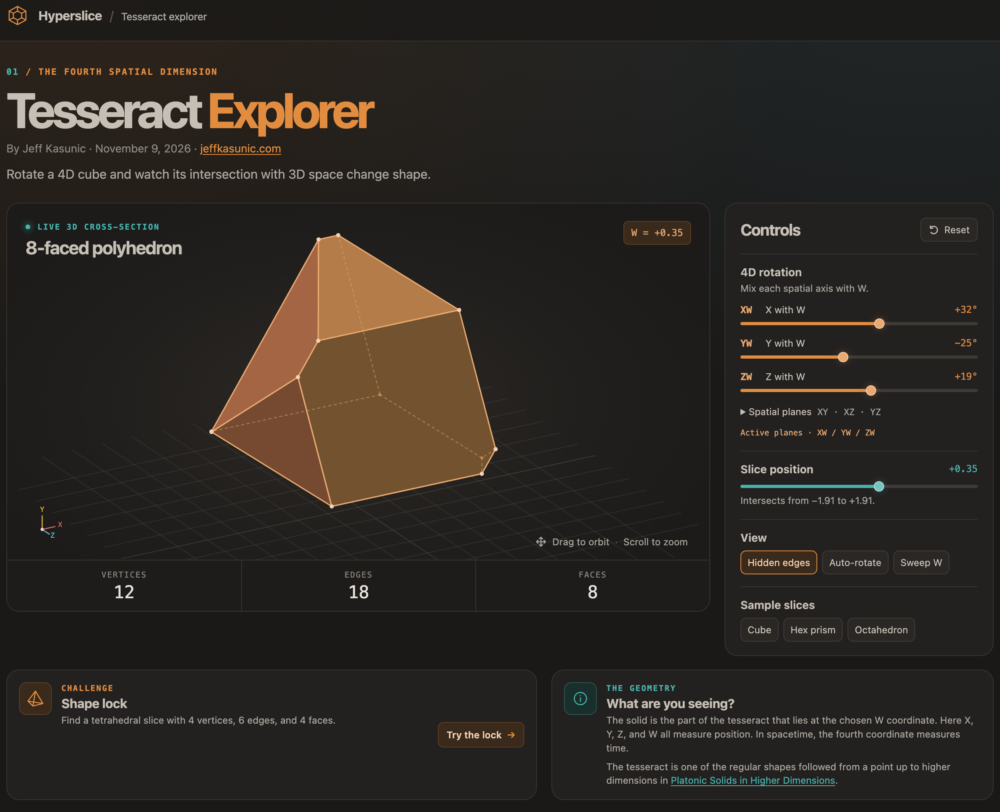

# Hyperslice

An interactive tesseract explorer. Rotate a 4D cube and watch the 3D shape it
makes where it crosses ordinary space: cubes, prisms, octahedra, tetrahedra and
more.

By Jeff Kasunic · November 9, 2026 · [jeffkasunic.com](https://jeffkasunic.com)

For the regular shapes in every dimension, from a point up through the
tesseract and beyond, see
[Platonic Solids in Higher Dimensions](https://jeffkasunic.com/mathematics/platonic-solids.html).



## Features

- **4D rotation:** mix each spatial axis with W (XW, YW, ZW), then turn the
  slice in 3D (XY, XZ, YZ).
- **Slice position:** slide the 3D plane along the W axis.
- **Live cross-section:** vertex, edge and face counts, plus a name for the
  shape that is only given when the geometry really matches it.
- **View options:** show or hide hidden edges, auto-rotate, and sweep W
  automatically.
- **Sample slices:** jump to a cube, hexagonal prism or octahedron.
- **Shape lock challenge:** find a tetrahedral slice. Your best score is saved
  in the browser.

### Controls

| Action | Mouse / trackpad    | Keyboard (view focused) |
| ------ | ------------------- | ----------------------- |
| Orbit  | Drag                | Arrow keys              |
| Zoom   | Scroll or pinch     | `+` / `-`               |

## Getting started

Requires [Node.js](https://nodejs.org/) 20.19+ or 22.12+.

```sh
npm install
npm run dev
```

Then open the local URL Vite prints.

### Scripts

| Command             | What it does                                       |
| ------------------- | -------------------------------------------------- |
| `npm run dev`       | Start the dev server with hot reload               |
| `npm run build`     | Type-check, then build for production into `dist/` |
| `npm run preview`   | Serve the production build locally                 |
| `npm run typecheck` | Type-check only                                    |

## Deploying

Run `npm run build` and upload the **contents** of `dist/` to any static web
host. Asset paths are relative (`base: "./"` in `vite.config.ts`), so the site
works at a domain root or in a subfolder.

Don't upload the project's top-level `index.html`. It points at the TypeScript
source and only works with the dev server.

## Project structure

```
index.html            Page markup
assets/               README screenshot (not part of the build)
public/               Favicons, copied to dist/ as-is
src/
  main.ts             UI, rendering, input and the challenge
  geometry.ts         Tesseract, 4D plane rotations and slicing at W = offset
  shapes.ts           Names a slice from its faces and measurements
  styles.css          Styles
vite.config.ts        Build config
```

Built with TypeScript and [Vite](https://vite.dev/), with no runtime
dependencies. The 3D view is drawn as SVG.
